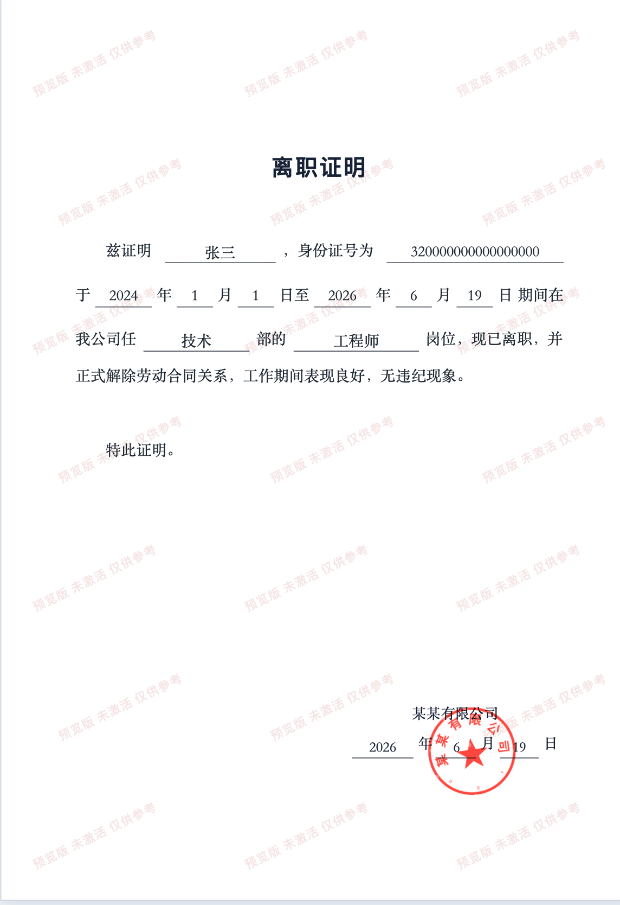

# 离职证明演示工具 · 个人所得税模拟器

**技术交流学习 · 虚构示例演示 · Mou652 / MouJC**

## 联系与版本咨询：QQ `2430239942`

交流离职证明版式、界面交互、个人所得税模拟器使用与教学演示。联系时请说明产品、设备和系统版本。

[离职证明网站](https://geshui-apk.moujc.cn/leave-certificate/) · [直接打开编辑工具](https://geshui-apk.moujc.cn/leave-certificate/editor.html) · [GitHub 宣传仓库](https://github.com/Mou652/leave-certificate-demo) · [Gitee 国内入口](https://gitee.com/MouJC/leave-certificate-demo)

## 两款产品，一处了解

| 产品 | 用途 | 使用入口 |
| --- | --- | --- |
| **离职证明演示工具** | 编辑虚构示例资料、预览版式、调整公章，激活后导出无产品水印 PDF | [在线使用](https://geshui-apk.moujc.cn/leave-certificate/editor.html) |
| **个人所得税模拟器** | 演示个税 App 界面、年度查询、收入纳税明细与个人中心，制作教学截图和录屏 | [官网与教程](https://geshui.moujc.cn/) · [安卓下载](https://geshui-apk.moujc.cn/) |

## 离职证明演示工具

网站已于 **2026-11-08** 部署。填写资料后可查看带水印预览；输入有效激活码，服务端确认授权后可导出无产品水印 PDF。

1. 打开[编辑工具](https://geshui-apk.moujc.cn/leave-certificate/editor.html)，填写虚构示例姓名、单位、岗位与日期。
2. 核对预览，按需调整公章大小、位置、文字与颜色。
3. 点击“导出 PDF”，输入20位字母数字激活码；获取与使用咨询 QQ **2430239942**。
4. 下载 PDF 后打开查看或打印。已激活浏览器刷新页面可重新验证，无需重复消耗激活码。

激活按浏览器安装身份绑定。清除站点数据、使用无痕窗口或换浏览器可能丢失本机身份，需要新的激活码。离职证明和个税的授权独立，激活码不能混用。

### 离职证明版式参考

以下为用户提供的原始版式参考截图，使用虚构示例资料，保留原图预览水印。正式授权导出的 PDF 不叠加产品水印。

### 服务端激活与导出

每次导出都重新请求一次性挑战并签名，服务端检查 Redis 授权及本次资料摘要。无水印 PDF 由服务端生成并直接传输，不放入公开下载目录。前端标记不构成授权；无效码、篡改请求、重放和已撤销授权会被拒绝。

已完成16项服务端测试、Chrome 1440/768/390宽度检查及实际 PDF 下载核对；真实 HTTPS 接口已检查激活、码消费、无水印 PDF、重放拒绝和撤销拒绝。未完成所有手机系统与浏览器的实机兼容测试。详见[实现与验收记录](docs/development-plan.md)。

安全目标是阻止常见授权绕过，不承诺绝对无法破解；已授权下载文件也无法防止被复制或转发。

## 个人所得税模拟器

**个人所得税模拟器**也称个税模拟器、个税 App 模拟器，是个人维护的非官方界面教学演示项目。使用本机保存的虚构资料，展示收入纳税明细、工资薪金记录、年度筛选与个人中心等页面。

- **支持平台**：Android 安卓、iPhone / iOS，具体设备与版本通过 QQ 咨询。
- **示例配置**：设置演示姓名、任职单位、年度、月份与收入等虚构资料。
- **教学展示**：浏览年度汇总和月度记录，使用系统截图与连续录屏制作讲解素材。

| 阅读入口 | 地址 |
| --- | --- |
| 官网与完整教程 | [geshui.moujc.cn](https://geshui.moujc.cn/) |
| 安卓下载与安装 | [geshui-apk.moujc.cn](https://geshui-apk.moujc.cn/) |
| GitHub 项目介绍 | [Mou652/geshui-simulator](https://github.com/Mou652/geshui-simulator) |
| Gitee 国内项目介绍 | [MouJC/geshui-simulator](https://gitee.com/MouJC/geshui-simulator) |
| 首次使用 | [版本说明与开始使用](https://geshui.moujc.cn/guides/getting-started.html) |
| 截图与录屏 | [iPhone 截图录屏教程](https://geshui.moujc.cn/guides/screenshot-and-recording.html) |

### 个税模拟器界面预览

<table>
<tr><th>收入纳税明细 · 模拟演示</th><th>年度筛选 · 模拟演示</th></tr>
<tr><td></td><td></td></tr>
</table>

国内阅读也可从 [Gitee 个税模拟器仓库](https://gitee.com/MouJC/geshui-simulator)查看截图和教程。

## 常见问题

**导出会带水印吗？** 预览带提示水印；服务端授权通过后导出的 PDF 不叠加产品水印，已核对实际下载文件可打开、中文可读。

**激活码在哪里输入？** 点击“输入激活码”或“导出 PDF”。以前激活过同一浏览器时可点击“重新验证”。

**手机可以用吗？** 已适配手机宽度和填写/预览切换；当前浏览器验收使用 Chrome 响应式视口，不代表已验证所有 iPhone、安卓机型与内置浏览器。

## 技术交流学习说明

项目用于技术交流学习、版式研究与虚构场景演示。离职证明演示文件不作为真实人事证明；个人所得税模拟器与税务机关及官方 App 无关联，不连接官方税务系统，模拟画面不代表真实收入、纳税或身份记录。

本仓库仅公开宣传资料和实现说明，不公开私有服务端、激活数据或可构建的个税 App 源码。原创文档采用 [MIT License](LICENSE)，不涉及仓库外的应用、服务或第三方标识与素材。

## 联系维护者

**QQ：`2430239942`**

- 离职证明：版式与交互建议、激活与下载使用反馈。
- 个人所得税模拟器：安卓 / iPhone 演示版本、虚构资料配置、明细浏览与截图录屏。
- 公开反馈：[GitHub Issues](https://github.com/Mou652/leave-certificate-demo/issues) · [Gitee Issues](https://gitee.com/MouJC/leave-certificate-demo/issues)。

维护者：GitHub [Mou652](https://github.com/Mou652) · Gitee [MouJC](https://gitee.com/MouJC)。
